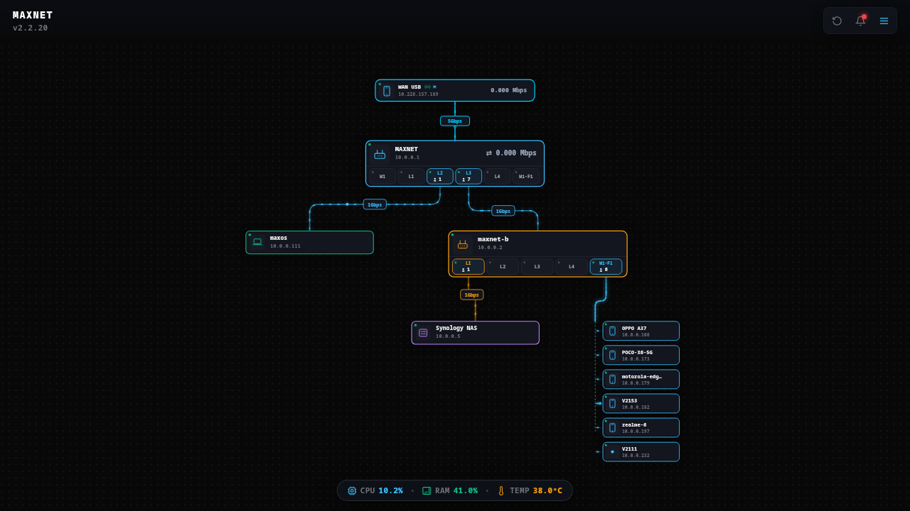
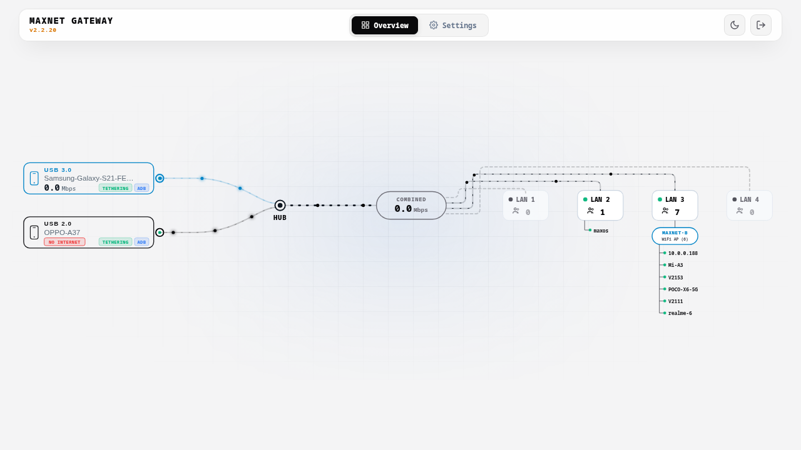
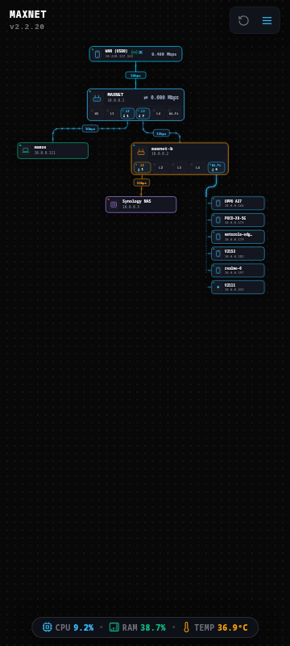
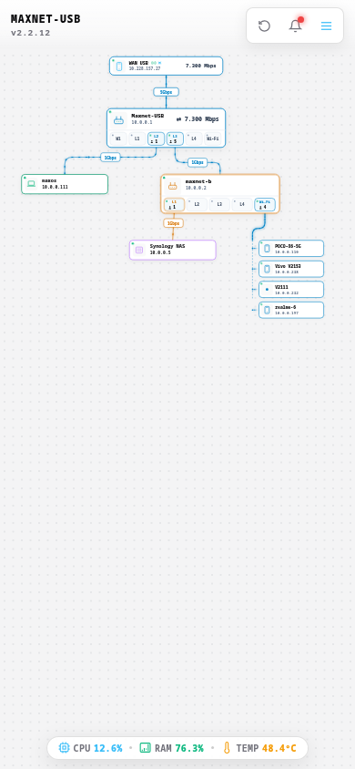
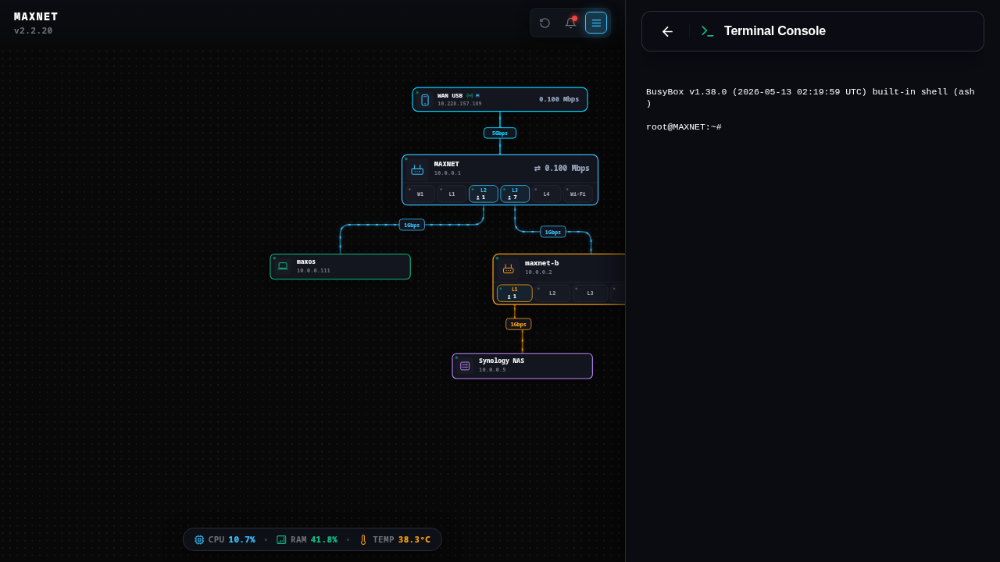
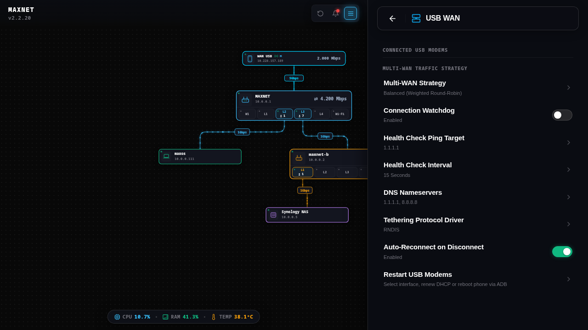
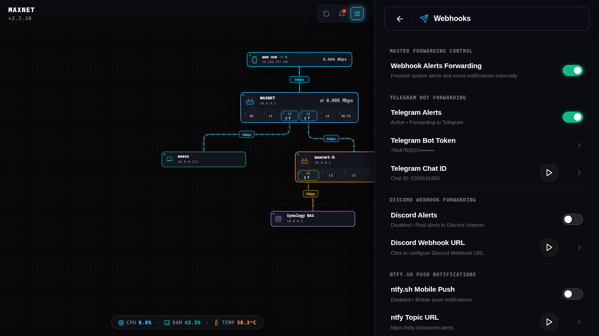
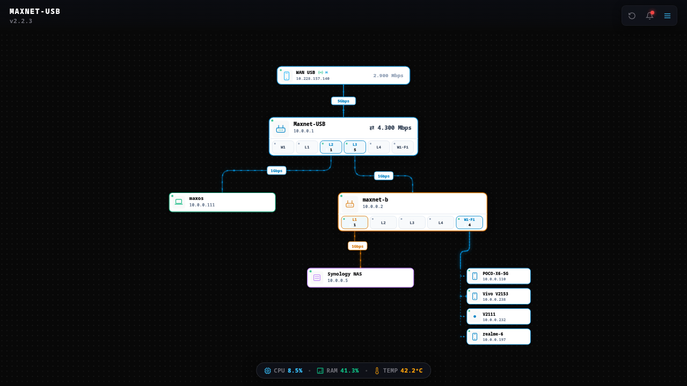
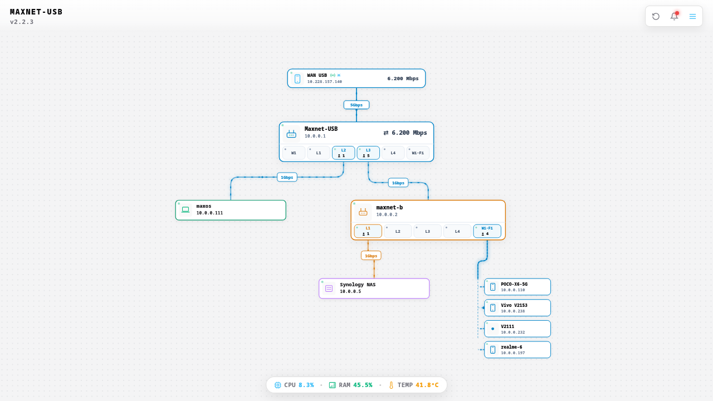
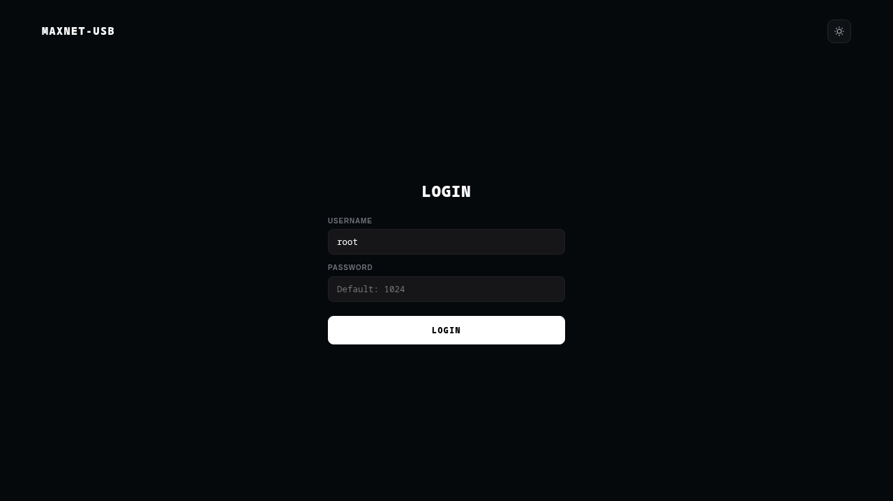

<div align="center">

# MAXNET Router OS
### Universal High-Performance OpenWrt Distribution for JioRouter AX6000 & AirFiber IDU Series
#### Supports Qualcomm IPQ9574 / IPQ9554 & MediaTek MT7986A Filogic 830

Official enterprise-grade OpenWrt **Linux 6.18 (AArch64 64-bit)** firmware engineered for high-throughput routing, dual-modem SuperSpeed USB 3.0 tethering, multi-link load balancing, ADB modem telemetry, automated Samba/DUFS storage, and a modern reactive cybernetic WebUI.

[](https://github.com/ohhmax/maxnet/actions/workflows/maxnet.yml)
[](https://github.com/ohhmax/maxnet/releases/latest)
[](LICENSE)

</div>

---

## Table of Contents

1. [Hardware Specifications & Device Matrix](#1-hardware-specifications--device-matrix)
   - [Qualcomm IPQ95xx Family](#qualcomm-ipq95xx-family-arm-cortex-a73)
   - [MediaTek Filogic 830 Family](#mediatek-filogic-830-family-arm-cortex-a53)
   - [Default Firmware Credentials](#default-firmware-credentials)
2. [Visual Interface & Screenshots](#2-visual-interface--screenshots)
   - [Desktop Views (Dark & Light Mode)](#desktop-views)
   - [Mobile Views (Dark & Light Mode)](#mobile-views)
   - [Operational Subsystems](#operational-subsystems)
   - [Firmware Upgrade Modal (Dark & Light Mode)](#firmware-upgrade-modal)
3. [Core Subsystems & Technical Architecture](#3-core-subsystems--technical-architecture)
   - [SuperSpeed USB 3.0 Multi-Packet Aggregation](#superspeed-usb-30-multi-packet-aggregation)
   - [Dual-Modem Multi-Link Load Balancing](#dual-modem-multi-link-load-balancing)
   - [Hardware Flow Offloading & PPE Acceleration](#hardware-flow-offloading--ppe-acceleration)
   - [Android Debug Bridge (ADB) Integration](#android-debug-bridge-adb-integration)
   - [Samba 4 & DUFS WebDAV Storage Engine](#samba-4--dufs-webdav-storage-engine)
   - [Embedded Web Terminal CLI](#embedded-web-terminal-cli)
   - [Mesh VPN & Remote Access (Tailscale / DuckDNS)](#mesh-vpn--remote-access)
4. [First-Time Installation & Flashing Guide via U-Boot](#4-first-time-installation--flashing-guide-via-u-boot)
   - [Step 4.1: Hardware Serial UART Connection](#step-41-hardware-serial-uart-connection)
   - [Step 4.2: Host PC TFTP Setup](#step-42-host-pc-tftp-setup)
   - [Step 4.3: Safe RAM Boot via TFTP (Testing Without Modifying Flash)](#step-43-safe-ram-boot-via-tftp-testing-without-modifying-flash)
     - [Qualcomm IPQ9574 U-Boot Commands](#qualcomm-ipq9574-u-boot-ram-boot-commands)
     - [MediaTek MT7986A Filogic U-Boot Commands](#mediatek-mt7986a-filogic-u-boot-ram-boot-commands)
     - [MediaTek Web Failsafe Recovery Method](#mediatek-web-failsafe-recovery-method)
   - [Step 4.4: Permanent Production Flash (Writing to Flash)](#step-44-permanent-production-flash-writing-to-flash)
     - [Method A: Terminal Flash via SSH (Recommended)](#method-a-terminal-flash-via-ssh-recommended)
     - [Method B: Web UI Upgrade Flow](#method-b-web-ui-upgrade-flow)
   - [Step 4.5: Permanent U-Boot Autoboot Configuration](#step-45-permanent-u-boot-autoboot-configuration)
5. [In-Router Automated OTA Updates](#5-in-router-automated-ota-updates)
   - [WebUI One-Click Update Flow](#webui-one-click-update-flow)
   - [Command Line OTA Execution](#command-line-ota-execution)
   - [Cryptographic Verification](#cryptographic-verification)
6. [Connected ADB Device & 5G Telemetry Management](#6-connected-adb-device--5g-telemetry-management)
7. [Frontend Development & Live Deployment](#7-frontend-development--live-deployment)
8. [Local Firmware Compilation](#8-local-firmware-compilation)
9. [Automated CI/CD Workflow](#9-automated-cicd-workflow)
10. [Troubleshooting & Frequently Asked Questions](#10-troubleshooting--frequently-asked-questions)

---

## 1. Hardware Specifications & Device Matrix

MAXNET provides tailored kernel configurations, device trees, and board profiles for both Qualcomm and MediaTek Jio AirFiber IDU revisions.

### Qualcomm IPQ95xx Family (ARM Cortex-A73)

- **CPU**: Qualcomm IPQ9574 / IPQ9554 (Quad-Core ARM Cortex-A73 @ 2.2 GHz, 64-bit AArch64)
- **RAM**: 512 MB DDR4 @ 1600 MHz
- **Flash**: 256 MB Winbond SPI Serial NAND (`W25N02KWZEIR`) with UBI / UBIFS
- **Switch**: 1x 2.5G/1G WAN (Blue Port) + 4x Gigabit LAN (Yellow Ports, `lan1`–`lan4`) with Qualcomm PPE Hardware Acceleration
- **USB Subsystem**: SuperSpeed USB 3.0 (`dwc3-qcom`, 5000 Mbps line rate)

| Model Name | Board ID / DTS | Canonical Sysupgrade Binary | Safe RAM-Boot (.itb) Image |
| :--- | :--- | :--- | :--- |
| **JIDU6811** | `jiorouter,ax6000-jidu6j11-6811` | `maxnet-jidu6811-sysupgrade.bin` | `maxnet-jidu6811-initramfs.itb` |
| **JIDU6911** | `jiorouter,ax6000-jidu6j11-6911` | `maxnet-jidu6911-sysupgrade.bin` | `maxnet-jidu6911-initramfs.itb` |
| **JIDU6611** | `jiorouter,ax6000-jidu6j11-6611` | `maxnet-jidu6611-sysupgrade.bin` | `maxnet-jidu6611-initramfs.itb` |
| **JIDU6411** | `jiorouter,ax6000-jidu6j11-6411` | `maxnet-jidu6411-sysupgrade.bin` | `maxnet-jidu6411-initramfs.itb` |
| **JIDU6111** | `jiorouter,ax6000-jidu6j11-6111` | `maxnet-jidu6111-sysupgrade.bin` | `maxnet-jidu6111-initramfs.itb` |
| **JIO JIDU6811** | `jio,jidu6811` | `maxnet-jidu6811-sysupgrade.bin` | `maxnet-jidu6811-initramfs.itb` |
| **JIO JIDU6911** | `jio,jidu6911` | `maxnet-jidu6911-sysupgrade.bin` | `maxnet-jidu6911-initramfs.itb` |

### MediaTek Filogic 830 Family (ARM Cortex-A53)

- **CPU**: MediaTek MT7986A Filogic 830 (Quad-Core ARM Cortex-A53 @ 2.0 GHz, 64-bit AArch64)
- **RAM**: 512 MB DDR4 RAM
- **Flash**: 256 MB SPI NAND / eMMC
- **Switch**: 1x 2.5G WAN + 4x Gigabit LAN via MT7531 Gigabit Switch with Hardware Flow Offload
- **USB Subsystem**: High-Speed USB 3.0 / USB 2.0 Host

| Model Name | Board ID / DTS | Canonical Sysupgrade Binary | Safe RAM-Boot (.itb) Image |
| :--- | :--- | :--- | :--- |
| **JIDU6801** | `jiorouter,ax6000-jidu6801` | `maxnet-jidu6801-sysupgrade.bin` | `maxnet-jidu6801-initramfs.itb` |
| **JIDU6401** | `jiorouter,ax6000-jidu6401` | `maxnet-jidu6401-sysupgrade.bin` | `maxnet-jidu6401-initramfs.itb` |
| **JIDU6101** | `jiorouter,ax6000-jidu6101` | `maxnet-jidu6101-sysupgrade.bin` | `maxnet-jidu6101-initramfs.itb` |
| **JIDU6601** | `jiorouter,ax6000-jidu6j01` | `maxnet-jidu6j01-sysupgrade.bin` | `maxnet-jidu6j01-initramfs.itb` |
| **JIDU6701** | `jiorouter,ax6000-jidu6j01` | `maxnet-jidu6j01-sysupgrade.bin` | `maxnet-jidu6j01-initramfs.itb` |
| **JIDU6201** | `jiorouter,ax6000-jidu6j01` | `maxnet-jidu6j01-sysupgrade.bin` | `maxnet-jidu6j01-initramfs.itb` |
| **JIDU6J01** | `jiorouter,ax6000-jidu6j01` | `maxnet-jidu6j01-sysupgrade.bin` | `maxnet-jidu6j01-initramfs.itb` |

### Default Firmware Credentials

| Parameter | Default Value | Notes |
| :--- | :--- | :--- |
| **Router LAN IP** | `10.0.0.1` | Subnet: `255.255.255.0` (`/24`), Secondary Alias: `10.0.0.254` |
| **Web Dashboard** | `http://10.0.0.1/` | Port 80, fast login (default user: `root`, default pass: `1024` or empty) |
| **SSH Terminal** | `ssh root@10.0.0.1` | Port 22, Dropbear server |
| **Web Terminal** | `http://10.0.0.1:7681/` | Embedded `ttyd` interactive console directly inside WebUI |
| **DUFS File Server** | `http://10.0.0.1:5000/` | High-speed WebDAV file sharing interface |
| **WAN Interface** | `wan_usb` (`usb0`) | Automatic DHCP client for USB 3.0 mobile tethering |

---

## 2. Visual Interface & Screenshots

### Desktop Views

| Desktop Dark Mode | Desktop Light Mode |
| :---: | :---: |
|  |  |
| *Interactive multi-layer topology with real-time bandwidth flows* | *Minimalist high-contrast light theme* |

### Mobile Views

| Mobile Dark Mode | Mobile Light Mode |
| :---: | :---: |
|  |  |
| *Touch-first responsive topology navigation* | *Light mode mobile layout* |

### Operational Subsystems

| Direct Terminal CLI | USB WAN Load Balancing | Automated Webhook Alerts |
| :---: | :---: | :---: |
|  |  |  |
| *Full root terminal over WebSocket* | *Dual-modem tethering controls* | *Multi-service notification engine* |

### Firmware Upgrade Modal

| Modal Dark Mode | Modal Light Mode | Live Flashing & Countdown |
| :---: | :---: | :---: |
|  |  |  |
| *Dark theme firmware comparison* | *Light theme firmware comparison* | *Live flash status & reconnect monitor* |

---

## 3. Core Subsystems & Technical Architecture

### SuperSpeed USB 3.0 Multi-Packet Aggregation

Stock Linux kernels (`rndis_host.c`) assume a 1:1 ratio between USB bulk transfers and network packets (`sk_buff`). Modern 5G handsets (such as Samsung Galaxy devices on Android 14/15/16) aggregate dozens of Ethernet frames into single 32 KB URB transfers with trailing zero-padding. Standard drivers interpret this padding as frame length errors, accumulating `rx_errors` and triggering `EVENT_RX_KILL`.

MAXNET embeds two kernel patches resolving this:
1. **`0800-net-usb-rndis_host-support-superspeed-aggregation.patch`**:
   - Enables `FLAG_MULTI_PACKET` on the RNDIS device descriptor.
   - Implements a frame-extraction loop in `rndis_rx_fixup()` that unpacks each frame into its own `sk_buff` and terminates gracefully on padding zeros.
2. **`0801-net-usb-usbnet-prevent-rx-queue-starvation.patch`**:
   - Expands SuperSpeed `rx_qlen` to **32 URBs (~1 MB depth)** and `tx_qlen` to 64 URBs.
   - Refills the RX ring immediately when `dev->rxq.qlen == 0`, eliminating controller deadlocks during heavy line-rate bursts.
   - Verified sustained line-rate transfers (>450 Mbps) with **0 packet drops and 0 errors**.

### Dual-Modem Multi-Link Load Balancing

The `multilinkd` daemon monitors two cellular modems connected simultaneously via USB 3.0 and USB 2.0:
- Supports RNDIS, CDC-NCM, CDC-Ether, QMI, and MBIM drivers.
- Dynamic route weights based on real-time link latency and packet loss.
- Seamless automatic failover: if primary tethering drops, traffic shifts to the secondary interface within 1.5 seconds.

### Hardware Flow Offloading & PPE Acceleration

- **Qualcomm PPE (Packet Processing Engine)**: Hardware NAT offload for IPQ9574 routing all 4 yellow LAN ports (`lan1`–`lan4`) and the 2.5G blue WAN port at wire speed with `< 1%` CPU utilization.
- **Shortcut-FE**: Fast routing path accelerating inter-VLAN and bridged traffic.
- **MediaTek MT7531 HW Flow Offload**: Hardware-accelerated switching on MT7986 Filogic platforms.

### Android Debug Bridge (ADB) Integration

MAXNET integrates a native ADB daemon and wrapper:
- Passwordless USB debugging with pre-installed router authorization keys.
- Real-time telemetry: battery temperature, battery health, voltage, CPU load, and 5G signal metrics (RSRP, RSRQ, SINR, 5G NR band).
- Remote management commands: SMS inbox viewing, contact lookup, phone reboot, and screen captures.

### Samba 4 & DUFS WebDAV Storage Engine

- Hotplug automount daemon (`50-pendrive-smb`) detects USB pendrives, SSDs, and hard drives formatted in NTFS (via `ntfs-3g`), exFAT, FAT32, EXT4, and F2FS.
- **Samba 4**: Multi-user SMB sharing with pre-configured guest access.
- **DUFS WebDAV**: Lightweight file server running on port 5000 with a dedicated MAXNET file browser interface.

### Embedded Web Terminal CLI

- Embedded `ttyd` terminal running on port 7681 with xterm.js integration.
- Full root shell access directly inside the WebUI without requiring third-party SSH clients.
- Clean transparency matching the active desktop theme.

### Mesh VPN & Remote Access

- **Tailscale**: One-click WireGuard mesh VPN integration with QR code login and subnet routing.
- **DuckDNS**: Automated Dynamic DNS updating with HTTPS certificate provisioning.

---

## 4. First-Time Installation & Flashing Guide via U-Boot

If your router is currently running stock Jio firmware or needs recovery, flash MAXNET using U-Boot serial console access.

### Step 4.1: Hardware Serial UART Connection

1. Disconnect the power adapter from the router.
2. Remove the router casing to access the 4-pin UART serial header on the PCB:
   - **GND** -> Connect to adapter GND
   - **TX** -> Connect to adapter RX
   - **RX** -> Connect to adapter TX
   - **VCC (3.3V)** -> **LEAVE DISCONNECTED**. Do not connect the power pin.
3. Plug your USB-to-UART serial adapter (set to 3.3V TTL logic level) into your computer.
4. Open a serial terminal on your host machine:
   ```bash
   picocom -b 115200 -d 8 -p n -f n /dev/ttyUSB0
   ```
5. Plug the router power adapter in. As text begins streaming, repeatedly press `Enter` or `Space` to interrupt the autoboot counter until you reach the U-Boot prompt:
   - Qualcomm: `IPQ9574#`
   - MediaTek: `MT7986#`

---

### Step 4.2: Host PC TFTP Setup

1. Assign a static IP address to your computer Ethernet interface:
   - **IP Address**: `192.168.1.2`
   - **Subnet Mask**: `255.255.255.0` (`/24`)
   - **Gateway**: `192.168.1.1`
2. Connect an Ethernet cable directly from your computer to **LAN Port 4** (or LAN Port 1) on the router.
3. Set up a TFTP server on your PC (e.g. `tftpd-hpa` on Linux or `Tftpd64` on Windows).
4. Download the model-matched files from [GitHub Releases](https://github.com/ohhmax/maxnet/releases):
   - Safe RAM-boot file: `maxnet-<model>-initramfs.itb`
   - Permanent sysupgrade file: `maxnet-<model>-sysupgrade.bin`
5. Place both files in your TFTP server root directory (e.g., `/srv/tftp/`).
6. If using Linux, temporarily disable firewalls that block TFTP:
   ```bash
   sudo ufw disable
   ```

---

### Step 4.3: Safe RAM Boot via TFTP (Testing Without Modifying Flash)

Before flashing permanent storage, boot MAXNET directly into RAM. This tests hardware compatibility, network routing, and the WebUI without writing to flash. If you power cycle the router, it returns to stock untouched.

#### Qualcomm IPQ9574 U-Boot RAM Boot Commands:
Enter these commands **one by one** at the `IPQ9574#` prompt:

```text
setenv ipaddr 192.168.1.10
setenv serverip 192.168.1.2
ping 192.168.1.2
```
Verify the output reports: `host 192.168.1.2 is alive`. Then run:

```text
dcache off; icache off
setenv fdt_high
setenv initrd_high
setenv bootargs "console=ttyMSM0,115200n8 earlycon"
tftpboot 0x46000000 maxnet-jidu6811-initramfs.itb
bootm 0x46000000
```

#### MediaTek MT7986A Filogic U-Boot RAM Boot Commands:
Enter these commands at the `MT7986#` prompt:

```text
setenv ipaddr 192.168.1.1
setenv serverip 192.168.1.2
ping 192.168.1.2
```
Verify `host 192.168.1.2 is alive`. Then run:

```text
tftpboot 0x46000000 maxnet-jidu6401-initramfs.itb
bootm 0x46000000
```

#### MediaTek Web Failsafe Recovery Method:
1. Power off the router.
2. Press and hold the **RESET** button.
3. While holding RESET, plug in the power cable.
4. Continue holding RESET for 8–10 seconds until the LAN LEDs flash rapidly.
5. Set your PC IP to `192.168.1.2/24` and open `http://192.168.1.1` in your browser.
6. Select `maxnet-jidu6401-sysupgrade.bin` and click **Upload and Flash**.

---

### Step 4.4: Permanent Production Flash (Writing to Flash)

Once the router finishes booting into RAM (approx. 30 seconds), access OpenWrt:
- **WebUI**: `http://10.0.0.1/` (User: `root`, Pass: `1024` or empty)
- **SSH**: `ssh root@10.0.0.1`

#### Method A: Terminal Flash via SSH (Recommended)

1. From your host computer, transfer the permanent sysupgrade binary:
   ```bash
   cat maxnet-jidu6811-sysupgrade.bin | ssh root@10.0.0.1 "cat > /tmp/sysupgrade.bin"
   ```
2. On the router SSH terminal, execute sysupgrade:
   ```bash
   sysupgrade -F -v -n /tmp/sysupgrade.bin
   ```
   *(The `-F` flag forces upgrade past initial board check differences; `-n` writes a clean overlay).*
3. The router writes the NAND/eMMC flash partitions and reboots in ~30 seconds.

#### Method B: Web UI Upgrade Flow

1. Open `http://10.0.0.1/` in your browser.
2. Navigate to **System -> Maintenance -> Firmware Update**.
3. Under **Flash new firmware image**, upload `maxnet-<model>-sysupgrade.bin`.
4. Check the **Force upgrade** box if prompted and proceed.

---

### Step 4.5: Permanent U-Boot Autoboot Configuration

To ensure the router automatically boots MAXNET from flash on every power cycle:

#### For Qualcomm IPQ9574:
Interrupt U-Boot at the `IPQ9574#` prompt and execute:

```text
setenv bootcmd "ubi part ubi; ubi read 0x44000000 kernel; bootm 0x44000000"
setenv fdt_high
setenv initrd_high
saveenv
reset
```

#### For MediaTek MT7986A Filogic:
Interrupt U-Boot at the `MT7986#` prompt and execute:

```text
setenv bootcmd "bootm"
saveenv
reset
```

The router will now boot permanently in 1 second on all future reboots.

---

## 5. In-Router Automated OTA Updates

Routers running MAXNET contain an automated update client querying releases at `https://github.com/ohhmax/maxnet/releases`.

### WebUI One-Click Update Flow

1. Open **System -> Maintenance -> Firmware Update**.
2. Click **Check Latest Updates**.
3. When an update is detected:
   - The subtitle displays: `Update <version> ready • <modelName>`.
   - The right-side check button morphs into a glowing **Flash Update** action button.
   - An in-app notification banner is dispatched once (duplicate notifications are automatically suppressed).
4. Click the Flash button to open the **Firmware Upgrade Modal**:
   - Compares the installed version against the latest build.
   - Shows detected hardware target, binary filename, and SHA256 checksum.
   - Choose:
     - **Keep Settings & Update**: Preserves network configurations, Wi-Fi keys, and passwords (`sysupgrade -F -v`).
     - **Clean Flash (Factory Reset)**: Wipes configuration partitions for a completely fresh install (`sysupgrade -n -F -v`).
5. A live countdown and reconnect monitor automatically tracks the reboot and refreshes the page when online.

### Command Line OTA Execution

```bash
# Check status:
/www/cgi-bin/update check

# Apply update keeping settings:
/www/cgi-bin/update flash

# Apply clean update:
/www/cgi-bin/update flash_clean
```

### Cryptographic Verification

Every release publishes a verified `manifest.json` and `sha256sums`. The router verifies the cryptographic SHA256 hash before writing to storage.

---

## 6. Connected ADB Device & 5G Telemetry Management

Manage connected smartphones directly from the router SSH terminal:

```bash
# Verify device connection:
adb devices

# Query active 5G cell details, signal RSRP & band:
adb shell "dumpsys telephony.registry | grep -m 1 mCellInfo="

# Query battery level & temperature:
adb shell "dumpsys battery | head -n 15"

# Lock screen capture:
adb shell "screencap -p /sdcard/screen.png"

# Reboot phone remotely:
adb reboot
```

---

## 7. Frontend Development & Live Deployment

The frontend is built with Vite 8, TypeScript, and Tailwind CSS in [frontend/](frontend/).

```bash
# Install dependencies:
cd frontend
npm install

# Run local dev server with proxy to router 10.0.0.1:
npm run dev

# Compile production bundle to files/www/dist/:
npm run build

# Deploy 1-second live atomic update to physical router:
./deploy-web.sh 10.0.0.1
```

---

## 8. Local Firmware Compilation

To build OpenWrt images locally on Linux:

```bash
# Build for Qualcomm IPQ95xx:
./build_firmware.sh qualcommbe

# Build for MediaTek Filogic:
./build_firmware.sh mediatek
```

Binaries output to:
- Qualcomm: `../openwrt/bin/targets/qualcommbe/ipq95xx/`
- MediaTek: `../openwrt/bin/targets/mediatek/filogic/`

---

## 9. Automated CI/CD Workflow

The GitHub Actions workflow [.github/workflows/maxnet.yml](.github/workflows/maxnet.yml) runs on every push:
1. Compiles modern Vite frontend and generates gzip pre-compressed assets.
2. Compiles OpenWrt images for both `qualcommbe` and `mediatek` targets in parallel.
3. Harvests `.bin` sysupgrades and `.itb` ram-boot images.
4. Generates `manifest.json` with cryptographic SHA256 checksums.
5. Publishes a multi-architecture GitHub Release automatically.

---

## 10. Troubleshooting & Frequently Asked Questions

#### Q: U-Boot reports `Console buffer overflow occured!!` or truncates pasted commands?
**A**: U-Boot serial console input buffers have a strict line length limit (~64 characters). Do not paste long concatenated commands in a single line. Enter each command individually as shown in the guide.

#### Q: TFTP transfer times out (`T T T T T`)?
**A**:
1. Confirm host PC Ethernet static IP is set to `192.168.1.2/24`.
2. Temporarily disable host firewalls: `sudo ufw disable` (Linux) or disable Windows Defender Firewall.
3. Verify TFTP service status: `sudo systemctl status tftpd-hpa`.

#### Q: LuCI reports `invalid sysupgrade file Image check failed`?
**A**: When migrating from stock firmware or initial RAM boot, OpenWrt metadata does not find existing board profiles in flash. Check the **Force upgrade** (`-F`) checkbox or pass `-F` via CLI.

#### Q: Can I change the router LAN IP?
**A**: Edit `/etc/config/network`:
```bash
uci set network.lan.ipaddr="192.168.1.1"
uci commit network
/etc/init.d/network restart
```

---

<div align="center">
Engineered for zero-compromise stability and wire-speed routing.
</div>
